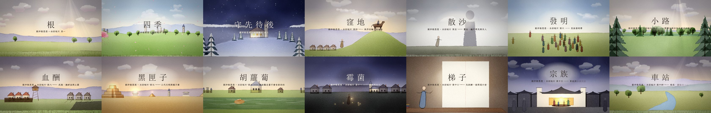
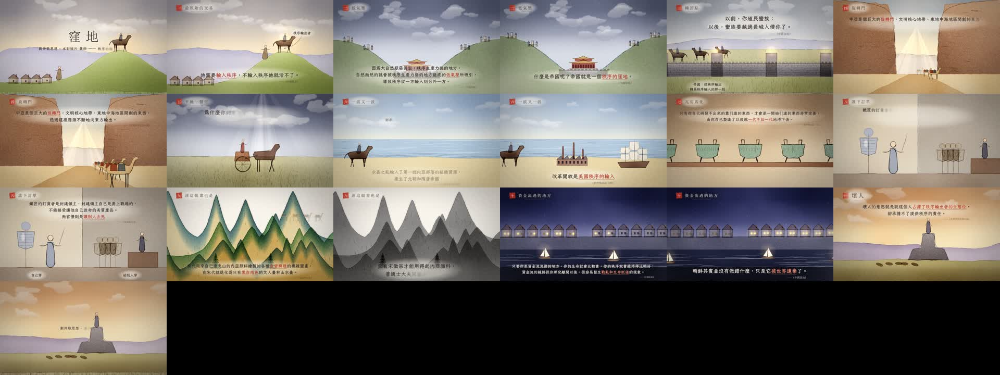
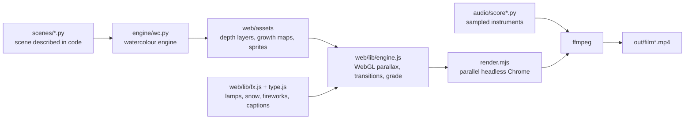

<p align="center">
  
</p>

# Liu Zhongjing in Watercolour

**Fourteen short explainer films on the thought of the historian and political theorist Liu Zhongjing (劉仲敬), drawn entirely in code.** Python paints procedural watercolour layers, WebGL and Canvas animate them, headless Chrome renders every frame and ffmpeg adds an original score played on recorded instruments. No image or video generation model, no photograph and no stock footage is used for the picture.

Each film takes one framework from his work and builds it as an argument in 7 to 13 chapters (claim → mechanism → historical examples → a twist → what follows), with on-screen Traditional Chinese captions. Every captioned quotation is verbatim from his writings, lectures and interviews and carries its source on screen.

The companion project [Liu Zhongjing's History, in Maps](https://github.com/ChanMeng666/lzj-history-maps) puts the same ideas on animated maps of the Chinese mainland, the People's Republic and the world.

## The films

| # | Title | Subject | Length |
|---|---|---|---|
| 1 | 《根》 *Roots* | Order grows, it is not designed; self-organising resources as a civilisation's capital; bureaucracy as the "harvester" that fixes its ceiling | 1:46 |
| 2 | 《四季》 *Four Seasons* | The seasons of a civilisation: feudal spring, free-city summer, bureaucratic autumn, the spending of the golden age, a winter of scattered sand, renewal from the frontier | 1:46 |
| 3 | 《守先待後》 *Keeping the Seed* | What survives the flood: the seed that must still sprout; digging holes and planting trees; hope kept in small groups | 1:38 |
| 4 | 《窪地》 *The Basin* | Order is imported and exported like weather; an empire as a basin of order; the revolving door of Inner Asia; imitation that degrades with every generation; a twist on the film's own medium | 2:30 |
| 5 | 《散沙》 *Scattered Sand* | Atomised subjects by design; the registered household; the economics of the cut-and-regrow harvest; why mutual harm is short-term rational; organisations that collapse under the first pressure; the golden age of the last men | 2:34 |
| 6 | 《發明》 *Invention* | Nations are invented; 1789 and 1848; empire's counter-nationalisms; the boomerang; borders before left and right; a world of many states | 2:59 |
| 7 | 《小路》 *The Footpath* | Common law as a path trodden through the forest; law found, not made; a market of precedents; the feudal contract; the jury; a state without a sovereign | 2:48 |
| 8 | 《血酬》 *Blood Reward* | Sovereignty from arms; pensions for the fallen; courage and fairness; local strongmen and militias; buying protection with salt; how repression selects tougher strains | 2:34 |
| 9 | 《黑匣子》 *The Black Box* | Three generations of civilisation; the Hebrew canon as a black box and seed bank; the steppe as an ocean; barbarian soil; piety over theology | 2:47 |
| 10 | 《胡蘿蔔》 *The Carrot* | His anti-self-help advice: happiness as morphine, the donkey and the carrot, the cost of pretending, acting before knowing, the moment of decision | 2:47 |
| 11 | 《霉菌》 *Mould* | Fervent believers produce order; mould keeps bacteria out; wiping it away lets the hardest strains in; the church as the root of welfare and the hidden root system of a civilisation; secular energy as reflected moonlight; winter, and the seeds that survive | 2:46 |
| 12 | 《梯子》 *The Ladder* | Liberal education: train first and ask why later; a sense of the board outlasts the material; the exam-taker as an endurance labourer; tacit skill; the classic as a seed; knowing as deleting; every map serves a purpose; the water spider; theory as a ladder | 2:39 |
| 13 | 《宗族》 *The Clan* | Family and the small community: the clan as an inner circle; organisation beats bloodline; the small community is the welfare system; marriage as alliance; eating the grandchildren's rice; climbing takes generations; children see backstage; rebuilding the small community | 2:42 |
| 14 | 《車站》 *The Station* | Nodes and founding: the pattern decides the path; between nodes you ride the rails, at a node you change trains; 1972 opening the sluice gate; decision as a wager and as childbirth; the Romulus moment; wandering scholars and rooted strongmen; founders; those who can wait | 2:41 |

Shot lists and the source of every quotation: [`docs/STORYBOARD.md`](docs/STORYBOARD.md) (films 1–3), [`docs/STORYBOARD_2.md`](docs/STORYBOARD_2.md) (films 4–10) and [`docs/STORYBOARD_3.md`](docs/STORYBOARD_3.md) (films 11–14).

<p align="center"></p>

## How a frame is made



1. **Painting (Python, numpy + OpenCV).** `engine/wc.py` keeps each layer as a transmittance map and glazes transparent pigment onto it in a simplified Kubelka–Munk way, so a yellow wash over a blue one really makes green. It models paper grain and granulation, pigment pooling at a wash's edge, wet-in-wet bleeding, backruns and lifting. Pen lines are generated with spline resampling, low-frequency tremor, pressure, a pressed start and a tapered finish, and dry-brush breaks. `engine/motifs*.py` hold the motifs: skies, mountains with snow caps, trees and roots, houses, castles, palaces and walls, figures, horses, camels, chariots, ships, bronze vessels, a blue-green landscape in mineral pigments, and more. Each scene in `scenes/film*.py` is split into depth layers and saved as WebP with optional growth maps (roots spreading, a tree growing, wheat cut, snow melting) and animation sprites. 153 scenes in all.
2. **Animating (browser).** `web/lib/engine.js` composites the layers in WebGL 2 with a parallax camera and growth masks; `fx.js` draws lamps, smoke, rain, snow, petals, leaves, fireworks, stars, fire and candlelight; `type.js` sets the captions (horizontal or vertical, ink bleeding in character by character, red-seal chapter cards, emphasis in vermilion, ink notes that point at objects in the picture). A post shader adds the grade, the paper, the vignette and a watercolour-bleed transition with a dark tide line. Every frame is a pure function of time.
3. **Rendering.** `render.mjs` serves `web/`, opens several headless Chrome workers, captures each frame and hands the sequence and the score to ffmpeg (x264, CRF 17, tuned for grain).

## The music

Each film has its own score (`audio/score.py` for films 1–3, `audio/score2.py` with the arrangement library `audio/arrange.py` for films 4–10, and `audio/score_film11.py` to `audio/score_film14.py` for films 11–14), written to the scene boundaries at 60 BPM and played back from recorded instruments by `audio/lib/sampler.py`: string sections, solo violin, woodwinds and brass from VSCO 2 Community Edition, the Salamander grand piano, harp, tubular bells, hand chimes, glockenspiel and the đàn tranh zither from VCSL, and erhu from Karoryfer. Sound effects are instruments too: a harp glissando for a falling seed, timpani and glockenspiel for fireworks, pizzicato for a clock. Loudness is normalised statically to −16 LUFS with a −1.5 dBFS ceiling.

## Run it

Requirements: Python 3 (numpy, opencv-python, scipy, soundfile, soxr, opencc), Node 18+, Google Chrome, ffmpeg. The instrument libraries are not in this repo; `audio/lib/sampler.py` reads them from `LZJ_INSTRUMENTS` (default `D:/github_repository/lemo-opuscar/core/audio/instruments`).

```bash
npm install
python engine/textures.py            # paper and transition noise
python engine/build.py --preview     # paint every scene (multiprocess); or: build.py film6
python audio/score.py all            # scores for films 1-3
python audio/score2.py all           # scores for films 4-10
for n in 11 12 13 14; do python audio/score_film$n.py; done   # films 11-14
node render.mjs film4 --stills 12,48 # check single frames
node render.mjs film4 --workers 6    # render out/film4.mp4 (resumable)
```

To scrub a film in a browser, serve `web/` and open `player.html?film=film4&preview`.

## Repository layout

| Path | Holds |
|---|---|
| `engine/` | watercolour engine, motif libraries, scene kit, parallel build |
| `scenes/` | one file per film: how each scene is painted |
| `web/` | player, compositing engine, effects, typography, timelines (`web/films/*.js`), painted assets, fonts |
| `audio/` | scores, arrangement styles, sampler |
| `docs/` | shot lists with quotation sources, README images |
| `render.mjs` | frame capture and encode |

## Credits

Ideas and quotations: Liu Zhongjing. Concept, code, painting engine, animation and scores by Chan Meng with Claude Code. Third-party components and their licences are listed in [`NOTICE.md`](NOTICE.md).
